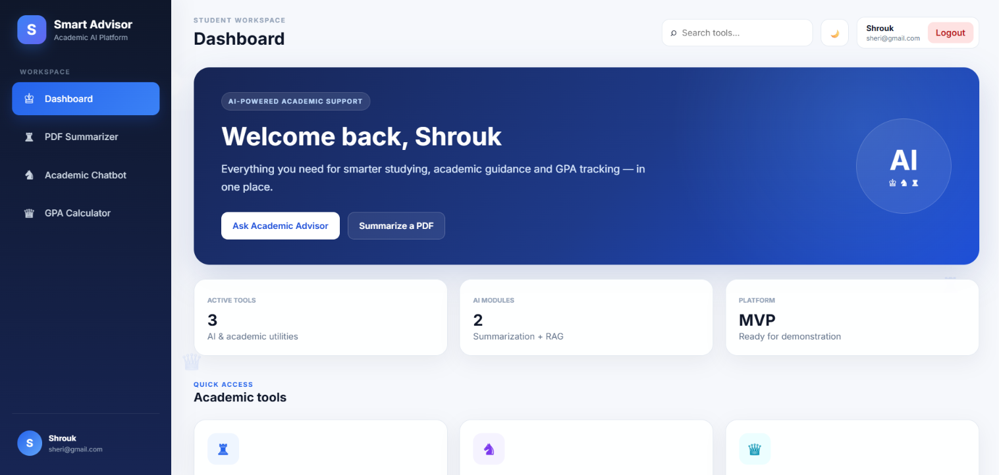
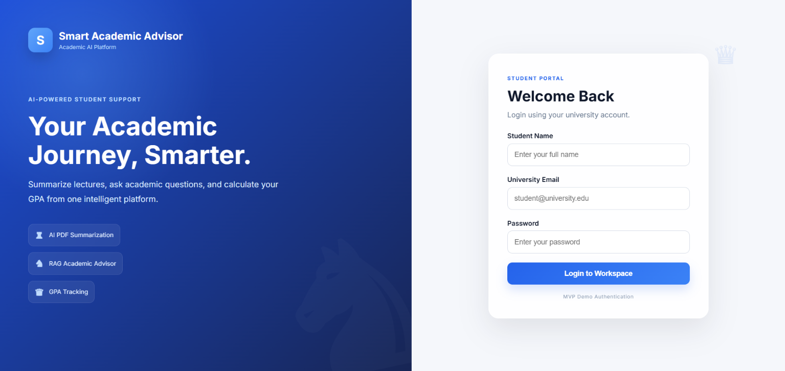
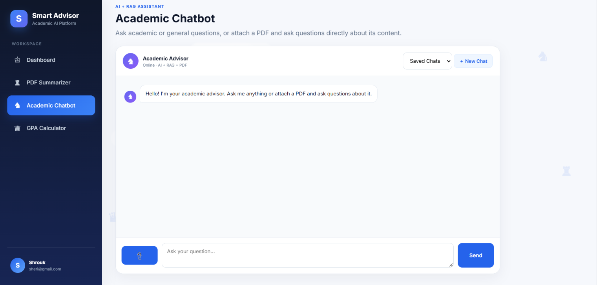
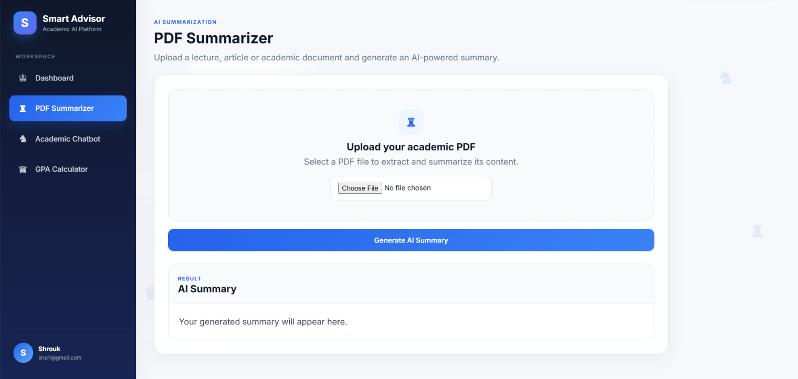
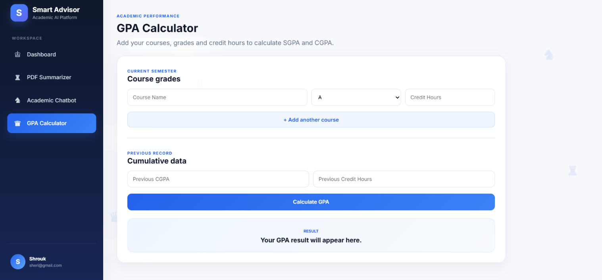
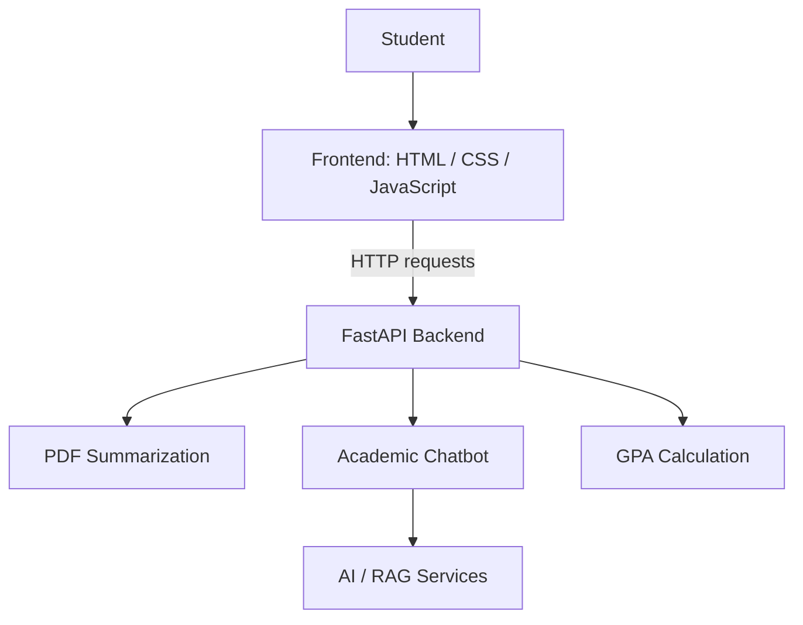

<div align="center">

# 🎓 Smart Academic Advisor

### An AI-powered academic workspace for university students

**PDF Summarization · RAG Academic Chatbot · GPA Calculator**


</div>

---

## 📖 Overview

**Smart Academic Advisor** is a student-focused academic workspace that brings document summarization, AI-assisted questions, and GPA tracking together in one interface. Its frontend communicates with a Python/FastAPI backend through HTTP APIs.

This repository is intended to contain **both the frontend and backend**. AI features require the backend, its dependencies, and any applicable service configuration to be running.

## 📸 Application Screenshots

### 🏠 Student Dashboard



### 🔐 Login Page



### 🤖 Academic Chatbot

Ask academic questions, work with chat sessions, and interact with PDF content.



### 📄 AI PDF Summarizer

Upload academic PDFs and view structured summaries.



### 📊 GPA Calculator

Enter course details and calculate academic averages.



---

## 🏗️ System Architecture



> High-level architecture. Backend internals and any external AI services should be checked against the actual Python implementation.

## ✨ Features

| Feature | Description |
| --- | --- |
| 🏠 Student Dashboard | Central navigation, student profile, and quick access to academic tools |
| 📄 PDF Summarizer | Upload PDFs and display formatted AI-generated summaries |
| 💬 Academic Chatbot | Ask questions, upload PDFs, and work with chat sessions |
| 📊 GPA Calculator | Enter course information and request GPA calculations |
| 🌗 Theme Switcher | Switch between light and dark modes |
| 🔐 Demo Login | Save student details and demo login state in browser storage |

## 🛠️ Tech Stack

- **Frontend:** HTML5, CSS3, vanilla JavaScript, Fetch API, `localStorage`
- **Backend:** Python, FastAPI, HTTP API endpoints
- **Interface:** Responsive layout, Inter font, animated elements, light/dark theme
- **AI functionality:** PDF summarization and chatbot/RAG integration through the backend (exact dependencies depend on the backend implementation)

## 📁 Project Structure

```text
smart_academic_advisor/
├── app/                         # Python / FastAPI backend
├── frontend/
│   ├── index.html               # Main student workspace
│   ├── style.css                # Dashboard styles
│   ├── script.js                # UI logic and API requests
│   ├── login.html               # Demo login page
│   ├── login.css                # Login styles
│   └── login.js                 # Demo login logic
├── assets/
│   └── screenshots/
│       ├── dashboard.png
│       ├── login.png
│       ├── chatbot.png
│       ├── pdf-summarizer.png
│       └── gpa-calculator.png
├── requirements.txt             # Backend Python dependencies
├── .gitignore                   # Local files excluded from Git
└── README.md
```

## 🚀 Getting Started

### 1. Clone the repository

```bash
git clone https://github.com/YOUR_USERNAME/smart_academic_advisor.git
cd smart_academic_advisor
```

Replace `YOUR_USERNAME` and the repository name with your actual GitHub details.

### 2. Create a Python virtual environment

```bash
python -m venv .venv
```

**Windows (PowerShell):**

```powershell
.\.venv\Scripts\Activate.ps1
```

**macOS / Linux:**

```bash
source .venv/bin/activate
```

### 3. Install backend dependencies

```bash
python -m pip install -r requirements.txt
```

If the backend requires environment variables or external API credentials, configure them locally according to the Python code. **Never commit real API keys or `.env` files.**

### 4. Start the FastAPI backend

If the FastAPI application is defined as `app` in `app/main.py`, run from the project root:

```bash
python -m uvicorn app.main:app --reload --host 127.0.0.1 --port 8000
```

**Note:** The FastAPI import path above is an example; replace `app.main:app` if your backend defines its application elsewhere. Confirm the actual entry point before running. If available, API documentation can be viewed at `http://127.0.0.1:8000/docs`.

### 5. Start the frontend

Open a **second terminal** in the project root:

```bash
cd frontend
python -m http.server 5500
```

Open **http://localhost:5500/login.html** in your browser.

### 6. Confirm the API connection

The frontend currently uses the following base URL in `frontend/script.js`:

```js
const API_BASE = "http://127.0.0.1:8000";
```

If your backend uses another host or port, update the value. Ensure the backend permits requests from `http://localhost:5500` through its CORS configuration when necessary.

> The dashboard and demo login are frontend features. PDF summarization, chatbot requests, and server-side GPA calculations require a compatible running backend.

## 🔌 API Integration

The frontend calls the following API routes. These are **frontend integration expectations**, not a verified inventory of the uploaded backend:

| Method | Endpoint | Purpose |
| --- | --- | --- |
| `POST` | `/api/pdf/summarize` | Summarize an uploaded PDF |
| `POST` | `/api/chatbot/session` | Create a chat session |
| `GET` | `/api/chatbot/history/{session_id}` | Retrieve chat history |
| `GET` | `/api/chatbot/sessions` | List user chat sessions |
| `GET` | `/api/chatbot/documents/{session_id}` | Retrieve session documents |
| `POST` | `/api/chatbot/upload-pdf` | Upload a PDF for chat |
| `POST` | `/api/chatbot/ask` | Send a question to the assistant |
| `POST` | `/api/gpa/calculate` | Request a GPA calculation |

The request and response contracts must match the actual FastAPI implementation.

## 🔍 How It Works

1. The student enters a name, email, and password on the demo login page.
2. The browser stores a demo login flag and student details in `localStorage`.
3. The dashboard provides access to PDF summarization, academic chat, and GPA tools.
4. JavaScript sends requests to the FastAPI backend and displays the responses.
5. The browser also retains the selected theme and some chat session information.

## ⚠️ Current Limitations

- **Demo authentication:** The frontend checks for filled fields and an `@` in the email. It does **not** authenticate credentials on a server. Do not treat this as production security.
- **Backend setup:** The precise Python entry point, environment variables, dependencies, and API contracts must be verified against the actual backend source.
- **Service dependency:** AI and GPA features need the corresponding backend services to be available.
- **MVP status:** Production use would require stronger authentication, authorization, validation, testing, and deployment configuration.

## 🧭 Future Improvements

- Secure authentication and account management
- Environment-specific API configuration
- Automated backend and frontend tests
- Hosted demo and deployment documentation
- Improved accessibility, validation, and error handling

## 👩‍💻 Project Notes

Developed as an academic MVP demonstrating frontend development, backend API integration, AI-powered academic workflows, and student-centered interface design.

---

<div align="center">

**Smart Academic Advisor — Study smarter, stay organized.**

</div>
